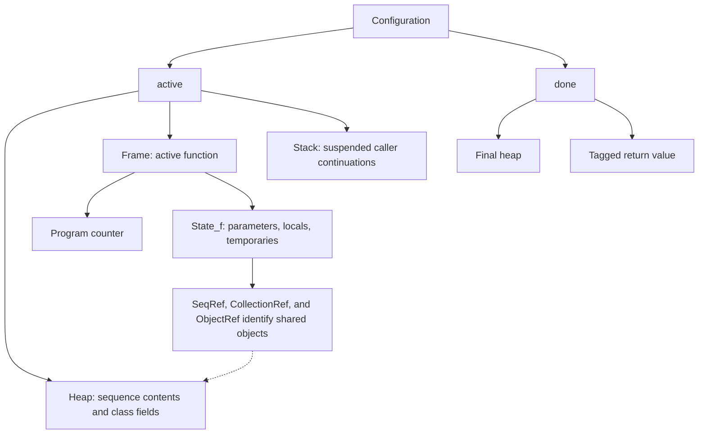

# Using the generated Lean interface

This guide describes the generated Lean definitions, execution interfaces, and
local observations. The compiler emits mathematical definitions and propositions;
compiling an algorithm does not run it or prove its correctness.

Public declarations are grouped under the source function's name. The ordinary
interface has two entry points, both taking mathematical inputs:

```lean
f.Returns input output
f.ValidTranscript input trace
```

Use `f.Returns` to state a returned value, and `f.ValidTranscript` to state that a
finite execution history is valid. For integer, Boolean, and integer-sequence inputs,
neither asks you to supply a heap: the compiler creates the initial sequence
objects automatically. Class-reference and typed non-integer sequence inputs
instead carry `(heap, arguments)`, and outputs of those types carry
`(finalHeap, reference)`, so shared object graphs remain meaningful. See
[classes and their field interface](CLASSES.md) and
[typed sequence descriptors](COLLECTIONS.md). To describe a
variable at a named line, use `f.At.label`, `f.Local.x`, or `f.Element.a` for a
sequence element. Most algorithm statements need only these names.

Programs with explicit `tick` statements also provide
`f.ReturnsWithCost input output costs`, connecting the returned value and
named counter increments to the same completed execution. The local accessor
`clock state name` observes a counter in a supplied configuration. See
[explicit cost counters](COSTS.md) for weighted ticks, call-summary reuse, and
the checked loop analysis.

For reusable correctness and runtime contracts, prefer `f.Call`: it describes a
completed invocation under any caller stack, starting with the caller's actual
heap and counters. Derive `f.Returns` and `f.ReturnsWithCost` results as convenient
views. `f.Run` describes a top-level execution; `f.CallFrom` completes an invocation
from a supplied intermediate configuration. `f.ValidHeapTranscript` exposes a
history with an explicit input heap. These interfaces share the same semantics.

### Choosing the statement interface

Keep theorem and helper-lemma statements at the level of source operations:

| Purpose | Interface |
| --- | --- |
| Reusable complete invocation | `f.Call` |
| Returned mathematical value and optional costs | `f.Returns`, `f.ReturnsWithCost` |
| Local loop invariant or continuation | `f.At.label`, `f.Local.x`, `f.Element.a`, `f.CallFrom` |
| Object representation | Generated `Ref_Class`, `is_Class`, `field_Class_field`, and typed sequence descriptors |
| One local transition | `Step before after`, with `Configuration` arguments |
| Several steps or a transcript invariant | Shared `Reaches`, `Valid`, `Deterministic`, and `Terminal` |

The editor's **Lean Interface** panel uses blue for propositions, purple for
theorems, green for values, and brown for types, matching `Int`. The same colors appear in generated
definitions, named-line definitions, analysis code, and main-result previews.
Data types and simple type aliases declared in analysis code also use brown;
this syntax coloring does not add them to the public interface.
Each interface specification also gives its kind in words. Shared storage tools
and the small **Advanced · local execution** group start collapsed.

Use **Save analysis** to download a complete Lean project as a ZIP. It includes
the current analysis, generated algorithm and named-line files, imported proof
modules, and required shared libraries such as `Algo2Lean.lean`. Extract it into
its own folder and run `lake build` to check the selected proof and its imports.
The package pins the Lean version and preserves module names and directory paths;
no manual copying of shared libraries is required.

The advanced layer includes configuration heap/stack projections and essential
execution types. A local assignment lemma can assume only `Step before after`
and a named location, without constructing a transcript. Generated `State_f`
records, numbered slots, and numbered transition constructors belong inside
proof bodies. Named observations and small mathematical predicates keep the
statements independent of these implementation details.

Coloring recognizes catalogued names, ordinary namespace/open declarations,
data declarations, and simple aliases to known types;
it is a navigation aid, not Lean elaboration or proof checking. Type-directed
notation such as `run.returns` or `heap.read` can remain uncolored even when it
uses a public interface. The explicit names `f.ReturnsWithCost.returns`,
`f.Returns.withCost`, and `Heap.read` are recognized. The two output/cost
conversion helpers remain available; neither introduces a separate execution.

The [companion algorithm](examples/interface.algo) and
[Lean examples](examples/interface.lean) demonstrate the interface with checked
proofs. See [Checking the examples](#8-checking-the-examples) for commands.

Contents: [terminology](#1-terminology-at-a-glance) ·
[structures](#2-how-the-structures-fit-together) ·
[calls](#3-what-happens-on-a-function-call) ·
[transcripts](#4-a-step-a-transcript-and-a-proof-of-validity) ·
[function API](#5-generated-function-interfaces) ·
[named locations](#6-named-locations-and-variable-access) ·
[proof tools](#7-proving-local-facts-and-reusing-them) ·
[checking examples](#8-checking-the-examples) ·
[current limits](#9-current-usability-limits).

## 1. Terminology at a glance

| Term | Meaning | Current Lean representation |
| --- | --- | --- |
| Integer sequence contents | The integer at every integer index. | `Seq := Int → Int` |
| Integer sequence reference | The identity of one mutable integer sequence. | `SeqRef := Nat` |
| Typed sequence reference | The identity of a non-integer sequence, including object and nested sequences. | `CollectionRef := Nat` |
| Sequence descriptor | A typed interface to a collection's validity, elements, updates, and allocation. | `SequenceType α`, with generated values such as `seq_Node` |
| Class reference | The identity of one mutable class instance. | `ObjectRef := Nat`, with generated aliases such as `Ref_Node` |
| Heap | Current integer sequences, class objects, typed collections, and explicit cost counters. | `Heap`, with separate reference spaces for each store |
| Cost counters | Named mathematical natural counts incremented by source `tick` statements. | `Clocks := String → Nat` |
| Local state | One invocation's parameters, local variables, and expression temporaries. | A generated record `State_f` |
| Program counter, or PC | Which lowered instruction will execute next. | `Nat` inside a frame |
| Frame | Which function is active, its PC, and its local state. | Generated tagged type `Frame` |
| Result | A returned value tagged with the function that returned it. | Generated tagged type `Result` |
| Continuation | How to resume a suspended caller when a callee returns. | `Result → Frame` |
| Stack | Suspended callers, with the most recent caller first. | `List (Result → Frame)` |
| Configuration | One complete execution snapshot: active or completed. | `Configuration := Algo2LeanCore.Config Heap Frame Result` |
| Transition, or step | One permitted change between configurations. | `Step before after : Prop` |
| Transcript | Explicit data listing successive configurations. | `Transcript := List Configuration` |
| Transcript validity | Evidence that the listed configurations follow `Step`. | `Algo2LeanCore.Valid Step initial trace final : Prop` |
| Reachability | Some finite valid transcript connects two configurations. | `Algo2LeanCore.Reaches Step initial final : Prop` |
| Function summary | A completed-call fact reusable under any caller stack. | `f.Call` |

An important naming distinction: **`State_f` is only local storage.** The generic
parameter named `State` in the shared `Valid` definition is instantiated with a
whole `Configuration` in generated programs.

## 2. How the structures fit together

An active configuration has three components. A completed configuration has
only the final heap and result:



The exact shared type is:

```lean
inductive Config (Heap : Type u) (Frame : Type v) (Result : Type w) where
  | active (heap : Heap) (frame : Frame) (stack : List (Result → Frame))
  | done (heap : Heap) (result : Result)
```

`Config` is reusable library code; `Configuration` is the generated abbreviation
that supplies this program's concrete `Heap`, `Frame`, and `Result` types.
`cfg.heap` accesses the heap in either variant.

### Heap: object identity and contents

The actual heap definitions begin with:

```lean
abbrev Seq := Int → Int
abbrev SeqRef := Nat
abbrev ObjectRef := Nat
abbrev CollectionRef := Nat
abbrev Clocks := String → Nat

structure Heap where
  nextRef : Nat := 0
  store : SeqRef → Seq := fun _ _ => 0
  nextObject : Nat := 0
  objects : ObjectRef → Option Object := fun _ => none
  clocks : Clocks := fun _ => 0
  nextCollection : Nat := 0
  collections : CollectionRef → Option Collection := fun _ => none
```

The shared `Object` record contains a class name and a map from field names to
optional tagged values (`Int`, `Bool`, sequence, collection or object references,
or `None`). The stores have separate reference spaces: sequence reference `0` and class
reference `0` do not identify the same object. Use generated helpers such as
`is_Node`, `field_Node_next`, and `create_Node` to describe class objects; see
[the class interface](CLASSES.md).

Non-integer typed sequences occupy the `collections` store. A generated
descriptor such as `seq_Node` exposes `.valid`, `.get`, `.set`, `.create`,
`.const`, and `.copy` without requiring proofs to inspect tagged values. Element observations
return `Option` values, and input validity checks allocation and the declared
element type without traversing the sequence. See the
[collection guide](COLLECTIONS.md) for heap construction and shallow copying.
The original integer store remains specialized, preserving the compact integer
sequence interface.

References `0, …, h.nextRef - 1` identify allocated sequences. `h.nextRef` is the
next fresh identity; it is **not a sequence length**. For reference `r` and
integer index `i`, `h.store r i` and `h.read r i` mean the element at that index.
The reference is a natural number; the element index is an integer and may be
negative.

Heap updates return new mathematical heap values:

| Operation | Effect |
| --- | --- |
| `h.read r i` | Read the contents of object `r` at index `i`. |
| `h.write r i value` | Return a heap with that element changed; object identity and `nextRef` stay the same. |
| `h.allocate contents` | Add a fresh object at the old `h.nextRef`, and increment `nextRef`. |
| `h.tick name amount` | Increase the selected counter by a natural amount (default one), preserving every object and collection store. |

Object writes and allocations preserve `clocks`. Generated `tick` transitions
change only those counters; ordinary control flow does not automatically count
as cost.

For example, `( {} : Heap).allocate (fun _ => 0)` has one allocated object,
reference `0`, containing zero at every index. Allocation returns the new heap;
the fresh reference is the old heap's `nextRef`.

If local variables `a` and `b` both contain reference `0`, writes through either
one affect the same object. If they contain different references, the objects
remain distinct even when their contents are equal. A source `copy(a)` allocates
an independent object. A source `b = a` copies only the reference.

These functions do not enumerate infinite sequences or impose a fixed memory
bound. There is no deallocation in the current language. Earlier heap values in
a transcript retain their old contents after later writes: the mathematical
values are immutable even though they model source-level mutation.

### Local state, frame, and PC

For a function `f`, `State_f` is a record. Its generated fields have names such
as `v0`, `v1` for source variables and `t2`, `t3` for expression temporaries;
comments identify the corresponding source names. Integer and boolean fields
contain values, integer sequence fields contain `SeqRef` identities, typed
sequence fields contain `CollectionRef`, and class fields contain references
such as `Ref_Node` or `Option Ref_Node` for nullable values.

A `State_f` record contains neither a heap nor a PC. The generated `Frame` type
adds the function identity and PC. For the companion example its shape is:

```lean
inductive Frame where
  | invalid
  | fn_assignment (pc : Nat) (state : State_assignment)
  | fn_touch (pc : Nat) (state : State_touch)
```

Each recursive invocation can have a different local record, even though all
invocations use the same `State_f` type. The record's default field values are
implementation placeholders; they do not mean an uninitialized source variable
has an observable value.

The PC is a compiler instruction number. It is not a source-line number or an
execution count, and it may change after source or compiler edits. One source
statement can require several instructions to evaluate operands, call a function,
and store a result. Prefer named locations over hard-coded PC values in user
statements. The current low-level proof interface sometimes still exposes PCs.

`Frame.invalid` is a sentinel for an incompatible return tag. It has no outgoing
steps. Generated call continuations expect the correct callee's result tag.

### Results and suspended callers

The companion program's returned values are represented as:

```lean
inductive Result where
  | fn_assignment (value : Int)
  | fn_touch (value : Int)
```

Other programs may mix integer, boolean, sequence-reference, class-reference,
nullable-reference, and `Unit` returns. The tag
allows one `Result` type to distinguish them. A returned sequence is an object
reference at this level; its contents are in the current heap.

A continuation has type `Result → Frame`. It captures the suspended caller's
locals, the destination for the returned value, and the PC where the caller
should continue. Applying it to the callee's result produces the resumed caller
frame. The stack is literally a list of these functions, **not a list of
`Frame` records or heap snapshots**. A continuation is generated implementation
data; normal callers should not need to construct it manually.

These are legitimate Lean values, but functions and infinite sequence contents
mean configurations are not ordinary printable or serializable log records.

## 3. What happens on a function call

Suppose `f` calls `g` while the stack is `rest`. After the call arguments have
been evaluated, the call step has this shape:

```text
active h (frame for f at the call) rest
    → active h (initial frame for g) (resume_f :: rest)
```

`g` can update the heap and make nested calls. When it eventually returns value
`v` with heap `h'`, returning resumes `f`:

```text
active h' (frame for g at return) (resume_f :: rest)
    → active h' (resume_f (Result.fn_g v)) rest
```

The resumed caller receives **the callee's final heap `h'`**. Restoring the old
heap would incorrectly undo mutations. The caller's suspended locals retain
references to the same objects, so they observe the new contents.

If the stack is empty, returning finishes the root invocation:

```text
active h' (frame for f at return) []
    → done h' (Result.fn_f v)
```

The library's `start h frame` creates an active configuration with an empty
stack. `resumeConfig h result stack` implements the choice between resuming a
caller and producing `done`.

While a callee runs, source-variable accessors refer to the active invocation.
A getter for a different suspended function returns `none`. In a recursive call
to the same function, the same getter can return the active callee's value at a
named point; it does not access the older suspended invocation. The current
interface has no convenience accessor for suspended callers' locals.

## 4. A step, a transcript, and a proof of validity

The generated declaration

```lean
Step : Configuration → Configuration → Prop
```

has constructors for individual lowered instructions: assignments, branch
choices, allocations, reads/writes, calls, and returns. A proof of
`Step before after` establishes one transition. It does not assert that `before`
is reachable from a function entry. No transition starts from `done`.

A transcript such as `[c0, c1, c2]` is data. The shared proposition

```lean
Algo2LeanCore.Valid Step c0 [c0, c1, c2] c2
```

requires `Step c0 c1` and `Step c1 c2`. The actual constructors are:

```lean
-- Singleton: zero transitions.
Valid.single state : Valid Step state [state] state

-- Add one transition before an already valid suffix.
Valid.cons transition suffix : Valid Step before (before :: rest) final
```

These are signature illustrations; `transition` proves `Step before after` and
`suffix` proves `Valid Step after rest final`.

A valid transcript is nonempty and contains both endpoints. Its number of
transitions is one less than its number of configurations. It can stop at an
active, stuck, or completed configuration. In particular, it can stop inside a
call that will never return. Being valid does not require being a maximal or
completed execution.

```lean
Reaches Step initial final := ∃ trace, Valid Step initial trace final
```

`Reaches` hides the particular history when only its endpoints matter. This is
defined through an existential proposition, not a second execution semantics. Transcript data lives in `Type`; `Step`, `Valid`, and `Reaches` live
in `Prop`. A proof can reason about an arbitrary valid transcript without
constructing all of its configurations.

## 5. Generated function interfaces

Every source function `f` gets the following declarations. For signatures without
class or typed non-integer sequence inputs, “value inputs” use `Seq` contents
functions; “reference inputs” replace each integer sequence argument with
`SeqRef`. Otherwise, public inputs supply `(heap, referenceInputs)`: typed
sequences use `CollectionRef` and classes use their generated reference aliases.

| Declaration | Arguments and meaning |
| --- | --- |
| `f.Returns input output` | Observe a returned value. Integer sequence outputs are contents functions; class and typed sequence outputs include the final heap with the reference. |
| `f.ReturnsWithCost input output costs` | The same completed execution produces the output and these clock increments. Available for programs with ticks, including through imports or abstract dependencies. |
| `f.Run h input h' output` | Valid inputs and a completed execution from `h` to `h'`; sequence outputs are references. |
| `f.Call h input h' output` | Valid inputs and a completed call under every caller stack, with the specified final heap and output (sequence outputs are references). |
| `f.CallFrom cfg h' output` | Complete the function from `cfg`'s current frame and heap, under every caller stack. |
| `f.ValidTranscript input trace` | Load value inputs automatically and describe a valid finite transcript from that initial configuration. |
| `f.ValidHeapTranscript h input trace` | Advanced form: valid reference inputs and some `final` with `Valid Step (f.initial h input) trace final`. |
| `f.ValidInput h input` | Reference inputs identify allocated objects in `h`. |
| `f.initial h input` | Build the root entry configuration from reference inputs. Does not itself prove their validity. |
| `f.load input` | Input → a pair `(initialHeap, referenceInputs)`. Automatically loads integer sequence values when no argument requires an explicit heap; otherwise uses the supplied pair. |

A method uses its source class and method names, such as `Counter.add.Call`;
the constructor uses `Counter.Call`. In a project, the module name encloses the
function namespace: `Algo.sorting.merge_sort.Call`. Opening `Algo.sorting`
lets a proof use `merge_sort.Call` directly.

Source names that need quoting in Lean are escaped component by component,
as in `«lemma».At.«by»`. The special source identifier `_root_` becomes
`«_root_·»`, since Lean treats `_root_` specially even when quoted. The editor
shows the exact generated names.

Input packaging follows the source signature:

| Number of arguments | Lean input |
| --- | --- |
| Zero | `Unit`, with value `()` |
| One | That argument directly |
| Two or more | A right-associated tuple, such as `(a, n, flag)` |

### Ordinary outputs

The companion `assignment` function can be described by
`assignment.Returns n 1`. For `touch`, use
`touch.Returns (xs, ys) result`, where `xs ys : Seq`.

Each sequence input is allocated separately. Even
`touch.Returns (xs, xs) result` creates **two objects with equal initial
contents**. It does not represent a call passing the same object twice.
The output view also hides changes to input objects unless they are reflected in
the returned value. Use the heap-aware interfaces when those effects matter.

A statement `f.Returns input output` is a proposition to prove, not a command
that computes `output`. Its truth asserts existence of a finite completed run.
It does not, by itself, establish uniqueness or termination for every input.
No output can also mean a stuck computation, such as division by zero.

### Supplying inputs to a transcript

Ordinary transcript statements take the same inputs as output statements:

```lean
-- xs ys : Seq; trace : Transcript
touch.ValidTranscript (xs, ys) trace
```

The heap and reference validity are handled internally through `touch.load`.
This creates distinct sequence objects, including when `xs` and `ys` are equal.
For two aliased arguments, use the advanced form and allocate one shared object:

```lean
let heap := ({} : Heap).allocate xs
touch.ValidHeapTranscript heap (0, 0) trace
```

For integer/boolean-only inputs the ordinary form uses an empty initial heap.
An arbitrary initial heap is also available through `f.ValidHeapTranscript` when
proving a reusable theorem. A function with no sequence inputs can still allocate
sequence objects later.

### Why inputs have a validity predicate

`SeqRef` is an unrestricted `Nat`. A raw input can therefore refer to an object
that has not been allocated. For `touch`, the check is exactly:

```lean
touch.ValidInput h (a, b) = (a < h.nextRef ∧ b < h.nextRef)
```

This equation describes the definition. It does not test sortedness, index
bounds, termination, or another algorithmic precondition. Negative element
indices remain valid. Class inputs additionally check their class membership;
typed sequence inputs check allocation and their element-type tag through
`seq_Node.valid`, for example. These checks stay shallow: they do not inspect
every entry or recursively follow references. For functions without reference
inputs the predicate is `True`.

The raw heap's `store` is a total function, even on unallocated references.
Input predicates and generated access guards prevent those arbitrary values
from being treated as allocated source objects. The raw `Heap.read` and
`Heap.write` helpers do not perform the allocation check themselves.

When the signature permits automatic integer-sequence loading, `f.load`
constructs valid references. Otherwise it uses the supplied heap and references,
whose validity is an input hypothesis. For the companion example, the following
proof is checked:

```lean
example (xs ys : Seq) :
    touch.ValidInput (touch.load (xs, ys)).1 (touch.load (xs, ys)).2 := by
  simp [touch.ValidInput, touch.load, Heap.allocate]
```

A theorem of this kind is not yet automatically generated for every function.
The ordinary output and transcript predicates incorporate validity internally.
Their users need not choose a heap or reference numbers when stating a claim.

### Reusing a function summary

The shared meaning of a summary is:

```lean
Summary Step h frame h' result :=
  ∀ stack,
    Reaches Step (.active h frame stack) (resumeConfig h' result stack)
```

It asserts existence of a completed call under every caller stack for those
particular inputs, final heap, and result. It is stronger than a conditional
claim that merely restricts what happens *if* the function returns. It
quantifies over callers so the callee's proved behavior can be used inside
another function. The generated `f.Call` supplies `f`'s entry frame and
adds input validity. Given `call : f.Call h input h' output`, use
`f.Call.run call` to obtain `f.Run h input h' output`. There is no transcript
to supply. For a proof that needs the shared-library representation, `call.1`
is input validity and `call.2` is the underlying `Summary`.

In project mode, importing the optional `Facts` module also provides
`f.Run.eq_of_call execution call`. This says an arbitrary completed run has the
same final heap and result as the proved call. It is useful for turning a
constructive call theorem into a correctness theorem about every completed run.
Generic modules additionally supply their dependency facts.

The converse conversion from an arbitrary output/execution theorem to a
contextual summary is not supplied. Start with `f.Call` when a call fact
must be reusable in surrounding executions.

For lower-level segments, use the shared `Reaches Step before after` directly.
`f.Run` describes an entire invocation; it is not an arbitrary segment relation.

For every function, `f.CallFrom cfg finalHeap result`
describes the remaining computation from a supplied configuration. It uses
`cfg`'s heap and local frame and quantifies over **every** caller stack; it does
not assume that `cfg` is reachable, and the stack stored in `cfg` is ignored.
It is false if `cfg` is completed or has another function active. Reference
validity and other necessary preconditions belong in the lemma using it.

This small view lets a loop helper take `cfg`, a named location, and ordinary
local-value equations. Its statement need not mention a generated state record,
instruction number, temporary field, or return continuation. It lives in the
general algorithm file, independently of labels, and adds no transition rules. See the
[loop analysis](../examples/analysis/sum_loop.lean) for an example.

## 6. Named locations and variable access

The companion source names the state before each statement with a standalone
comment directly above it, at the same indentation:

```python
def assignment(n: Int) -> Int:
    # @set
    a = 1
    # @ready
    return a
```

No blank or comment line may separate a label from its statement. Inline labels
are not supported.

This generates `assignment.At.set`, `assignment.At.ready`, and variable accessors
including `assignment.Local.a` in the separate `InterfaceGeneratedPoints.lean`
file. That file imports `InterfaceGenerated.lean`, whose definitions do not
change when labels change. Main theorem statements can import only the general
algorithm file; proofs needing observations import the `Points` companion.
See [the separation guide](NAMED_POINTS.md) for a fixed-statement example.

- `assignment.At.set cfg` means that the active function is `assignment` and its
  PC is immediately before evaluating the labeled assignment.
- `assignment.At.ready cfg` means it is immediately before evaluating the return.
- `assignment.Local.a cfg : Option Int` is `some a` at a named point where `a` is
  definitely initialized, and `none` elsewhere.

A getter is generated only when its variable is definitely initialized at at
least one explicit label. If there is no such point, the getter name is absent;
it is not a generated function that always returns `none`. Unlabeled functions
have no local getters.

`Option` belongs to the observation interface; the source variable itself is an
`Int`. `none` can mean an unlabeled PC, an uninitialized variable, another active
function, or a completed configuration. It does not establish that the variable
has never had a value in an earlier invocation.

An `At` predicate alone does not establish reachability. It also does not name a
particular recursive invocation: all invocations reaching that label match it.
There are no built-in invocation identifiers or k-th-visit accessors yet.

A location is before a source statement, and one source statement may span many
`Step`s. For whole-statement effects, use a segment expressed by `Reaches` when
needed. Assignments of total expressions over local values, such as `a = 1` or
`a = b + 1`, are one transition. Read-only sequence accesses, division, and
remainder can be fused with definedness guards. Calls and effects retain
explicit evaluation steps. Internal PCs and the number of transitions
can change as the compiler improves; named source locations are the intended
interface for algorithm statements.
A `while` label is visited before every condition evaluation, including the final
false check. A `for` label is visited before its range arguments are initialized
once per loop entry. Label a body statement for observations on each iteration.

### Reading sequence elements

Use `touch.Element.a cfg index : Option Int` to read a named sequence variable at
an integer index. For example, this proposition states that `a[0]` is 1 at the
named observation point:

```lean
touch.At.observe cfg ∧ touch.Element.a cfg 0 = some 1
```

The element accessor combines the reference getter with **the same
configuration's heap**, preserving historical contents. It is generated only for
sequence variables available at a named point, and returns `none` wherever the
underlying variable getter is unavailable. Negative indices work in the same way.
Like a raw heap read, it observes the supplied configuration; it does not certify
that its references are allocated or that the configuration is reachable.
Execution hypotheses supply those facts when they are needed.

The lower-level `touch.Local.a cfg : Option SeqRef` remains available for proofs
about object identities and aliases. Use `cfg.heap.read ref index` when working
with those explicit references.

Typed sequence variables use the same `f.Element.a` naming. For `a: Seq[Node]`,
the result is `Option Ref_Node`, read through `seq_Node.get` in the supplied
configuration's heap. For `a: Seq[Node | None]`, it is `Option (Option Ref_Node)`.
These getters additionally check the collection type and element encoding; they
do not recursively validate the object at the returned reference. Use the
class-field interface to observe that object's fields.

A typical intermediate-state assertion has this form:

```lean
-- Schematic: assumes f has a label test and initialized Int locals a and b.
∀ trace, f.ValidTranscript input trace →
  ∀ cfg ∈ trace, f.At.test cfg →
    f.Local.a cfg = some 4 → f.Local.b cfg = some 8
```

This states a property; it still needs a proof. Labels and source-variable names
let the statement avoid compiler PC numbers and temporary fields.

## 7. Proving local facts and reusing them

Here is a checked proof for the companion assignment, with no transcript or
entry-state assumption:

```lean
theorem assignment_local {before after : Configuration}
    (transition : Step before after) (location : assignment.At.set before) :
    assignment.At.ready after ∧ assignment.Local.a after = some 1 := by
  cases transition <;>
    simp_all [assignment.At.set, assignment.At.ready, assignment.Local.a]
```

It inspects the possible transition constructors and applies the assignment
rule. It does not build or enumerate an execution history.

The shared library provides these reusable tools, under `Algo2LeanCore`:

| Lemma | What it provides |
| --- | --- |
| `Valid.nonempty` | A valid transcript has at least one configuration. |
| `Valid.final_mem` | The final configuration is a member of the transcript. |
| `Valid.lift` | Turn a local fact about each `Step` into a fact about every adjacent pair in a valid transcript. |
| `Valid.invariant` | An initial property preserved by every step holds at the final configuration. |
| `Valid.all_states` | The same invariant holds at every member of the transcript. |
| `Valid.append` | Join two valid histories with a matching endpoint, keeping that endpoint once: `xs.dropLast ++ ys`. |
| `Reaches.refl` | Reach a configuration with zero steps. |
| `Reaches.single` | A single transition gives reachability. |
| `Reaches.trans` | Compose reachable segments. |
| `Reaches.prepend` | Put one local transition before a reachable segment. |
| `Reaches.invariant` | Propagate an invariant when the transcript witness is hidden. |
| `Valid.eq_of_terminal`, `Reaches.eq_of_terminal` | Two runs from the same start have equal terminal endpoints when `Step` is deterministic. |
| `Summary.root` | Specialize a reusable summary to a root invocation. |

`Deterministic Step` means a configuration has at most one successor;
`Terminal Step cfg` means it has none. Prove determinism once for the compiled
algorithm, then reuse terminal uniqueness to turn an existence proof into an
all-output theorem. The [GCD analysis](../examples/analysis/gcd.lean) demonstrates
this in `execution_correct` and `output_iff`.

Heap read/write/allocation simplification lemmas live in `Algo2LeanGenerated.Heap`.
They let a phase proof express its effect without repeatedly unfolding the heap's
implementation. `cfg.stack` is also available for segment lemmas that preserve
the suspended callers. Keep transition details inside phase helpers, then build
the main proof by composing their source-facing statements. The
[analysis guide](../examples/analysis/README.md#reusing-local-analysis) describes
this proof structure.

For example, `valid.lift` takes a proof that `Step a b` implies a relation `P a b`
and yields `Valid P initial trace final` for the same transcript. It does not by
itself extract a k-th visit. `valid.all_states` is useful for claims about every
state occurring in a valid history.

See the [companion Lean examples](examples/interface.lean) for a local fact lifted
to an arbitrary transcript. The more extensive
[transcript proof fixture](../tests/proofs/transcripts.lean) demonstrates
intermediate-value reuse in an output proof and a caller reusing a callee summary.
The [divergence fixture](../tests/proofs/transcript_divergence.lean) demonstrates
finite observations inside a nonterminating call.

## 8. Checking the examples

Run commands from the repository root with the pinned Lean 4.33.1 toolchain
installed:

For analyses maintained as separate importing modules:

```sh
python3 -m algo2lean analyze examples/gcd.algo examples/analysis/gcd.lean
```

For the guide's independent tutorial file:

```sh
python3 -m algo2lean analyze docs/examples/interface.algo docs/examples/interface.lean
```

This builds the algorithm and named-line modules, then checks the tutorial that
imports `InterfaceGeneratedPoints`. The examples use ordinary Lean tactics and the shared
library; they do not require the test suite's custom `algo_steps` tactic.

For default imported output instead, use `lake build` and `lake env lean` as
explained in the [README](../README.md). The reusable definitions are in
[Algo2Lean.lean](../Algo2Lean.lean), and generated declarations come from
[emitter.py](../algo2lean/emitter.py).

Library names such as `Valid` and `Reaches` live in `Algo2LeanCore`; concrete types
and `Step` live in `Algo2LeanGenerated`. Each public function interface lives in
its source function's namespace. `f.At`, `f.Local`, and `f.Element` live only in
the companion `Points` module. Use `open Algo2LeanCore Algo2LeanGenerated` in a
separate proof context as needed.

Use [project compilation](MODULES.md) to import independently compiled source
files. Their namespaces include their module names, such as `Algo.sorting`, so
their generated machines and function interfaces remain distinct. Legacy
single-file compilation still uses the shared top-level generated namespace.

## 9. Current usability limits

The current interface offers value-level outputs, named locations, and local
proofs, but still exposes implementation details in some tasks:

- Aliased inputs require allocation and shared references to be specified.
- Some call/return proofs still mention generated PCs, fields, and continuations.
- Input-loader validity lemmas and specialized local-effect lemmas are not
  automatically generated.
- K-th-visit queries, direct access to suspended caller locals, infinite
  transcript data, and automatic invariant proofs are not provided.

All existing views share the same `Step` and transcript validity core. Further
interfaces can be expressed as views and lemmas over that core, without adding
another evaluator. `f.ValidHeapTranscript` supplies an explicit heap;
`f.ValidTranscript` performs the same input loading as `f.Returns`.
